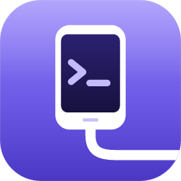

<div align="center">



# Tether

**A quiet, fast desktop GUI for Android Debug Bridge.**

Devices, screen mirroring, files, apps, logcat and shell in one
keyboard-first window.

<p>
  <a href="LICENSE"></a>
  
  
  
  
  
</p>
<p>
  
  
  
  
  
  
</p>
<p>
  <a href="https://github.com/kewldan/tether/actions/workflows/ci.yml"></a>
  <a href="https://github.com/kewldan/tether/releases/latest"></a>
  <a href="https://github.com/kewldan/tether/releases"></a>
  <a href="https://github.com/kewldan/tether/stargazers"></a>
  <a href="https://github.com/kewldan/tether/commits/main"></a>
  
  
  
  <a href="ROADMAP.md"></a>
</p>

</div>

---

Every Android developer has a text file of `adb` commands to copy from:
pull this file, clear that app's data, forward that port, grep logcat for a
crash. Tether puts all of it in one window. Plug in a phone or start an
emulator, and every screen works straight away: no command to remember, no
serial number to type.

It runs on the standard adb server, so Android Studio, scrcpy and your
terminal keep working next to it.

<!-- 📸 Hero screenshot / GIF goes here: docs/media/hero.png -->

## ✨ Highlights

- 📦 **Zero setup.** Already have adb? Tether finds it. Don't have it? One
  click downloads the official platform-tools straight from Google into the
  app. Nothing is installed system-wide.
- 🤝 **Plays nice with your tools.** Tether talks to the standard adb
  server, so Android Studio, scrcpy and your terminal keep working side by
  side. No fighting over USB.
- ⚡ **Native and tiny.** Built with Tauri and Rust: a small binary with low
  memory use, not another 200 MB Electron app.
- ⌨️ **Keyboard-first.** `⌘K` / `Ctrl+K` command palette for every action,
  device and screen.
- 🧠 **Speaks adb natively.** Uses the adb server protocol directly instead
  of scraping CLI output, so it stays fast and reliable.
- 🎨 **Designed, not assembled.** A dense, calm interface with real dark and
  light themes, spring animations and accessible contrast.
- 🔄 **Updates itself.** Signed over-the-air updates: one click, and it
  restarts on the new version.
- 🌍 **English and Russian** out of the box.

## 🧰 Features

| | Feature | What you get |
|---|---|---|
| 📱 | **Devices** | Live device list over USB, Wi-Fi and emulators, with clear states (unauthorized, offline, no permissions…) |
| 📦 | **adb setup** | Auto-detection of existing adb, one-click platform-tools download with license consent, and a notice when Google ships a newer one |
| 📶 | **Wi-Fi pairing** | Pair Android 11+ devices with a QR code or pairing code, or connect by IP |
| 🖥️ | **Screen mirroring** | Low-latency mirroring and control powered by scrcpy-server, device audio, MP4 recording with sound, a pop-out window and saved defaults |
| 📁 | **File manager** | Browse, preview (with photo EXIF) and transfer with a queue, compressed when the device allows; computer ⇄ device panes, drag files in and out |
| 🧩 | **Apps** | Install APK / split APKs on several devices at once, manage permissions, clear data, extract APKs, signing certificates, per-app data usage |
| 📜 | **Logcat** | A log viewer that keeps up: level, tag, package and regex filters, crash detection |
| 💻 | **Shell** | Multi-tab terminal with snippets and run-on-all-devices |
| 📊 | **Device overview** | Battery, storage, memory, CPU, display and network at a glance |
| 🎛️ | **Developer toggles** | Dark mode, animation scales, DPI, layout bounds, demo mode, system and per-app language, saved profiles and one-click revert |
| 🧮 | **Multi-device grid** | Every connected screen side by side; install, run, tap and screenshot on all of them at once |
| 📲 | **Sideload OTA** | Flash an OTA zip from recovery with progress and safety checks |
| 🔔 | **Menu bar & notifications** | Device status in the menu bar or tray; alerts when devices connect or an app crashes |
| 🔧 | **Power tools** | Port forwarding with live connections, intents & deep links, performance charts, bugreports, captures gallery with annotations |
| 🩺 | **Diagnostics** | "Can't see your device?" checklist that explains and fixes common problems |
| ⌨️ | **Keyboard-first** | Command palette, rebindable shortcuts, open at login straight into the menu bar |

What comes next is in the [🗺️ roadmap](ROADMAP.md).

## 📸 Screenshots

<!-- Screenshots and GIFs coming soon:
     docs/media/overview.png · docs/media/logcat.gif · docs/media/files.gif · docs/media/mirror.gif -->

_Coming soon._

## 🚀 Getting started

```bash
brew trust kewldan/tap && brew install --cask kewldan/tap/tether   # macOS
winget install kewldan.Tether                                    # Windows
```

Or download the installer for your OS from the
[latest release](https://github.com/kewldan/tether/releases/latest), or
build from source (see below).

On first launch Tether looks for an existing adb (PATH, `ANDROID_HOME`, the
Android Studio SDK, Homebrew, scoop, winget). If none is found, it offers to
download the official platform-tools for you.

**Prepare your phone:** enable *Developer options* (tap *Build number* 7
times), turn on *USB debugging*, connect the cable and approve the RSA
prompt.

> [!TIP]
> On Linux, install udev rules (`android-udev-rules` or your distro's
> equivalent) so non-root users can access the device.

## 🛠️ Development

**Prerequisites:** [Rust](https://rustup.rs) (stable), [Bun](https://bun.sh),
and the [Tauri prerequisites](https://tauri.app/start/prerequisites/) for
your OS.

```bash
bun install
bun run tauri dev     # run the app
bun run dev           # UI only, in the browser, with a mocked backend
bun run lint          # Biome
bun run build         # type-check and build the frontend
cd src-tauri && cargo test && cargo clippy --all-targets -- -D warnings
```

Releases and OTA updates are described in [docs/releasing.md](docs/releasing.md).

### 🏗️ Tech stack

- **Shell:** [Tauri 2](https://tauri.app) + Rust (`tokio`) speaking the adb
  server protocol on `localhost:5037`
- **UI:** React 19, TypeScript, Tailwind CSS v4,
  [shadcn/ui](https://ui.shadcn.com) on Base UI, Motion
- **Mirroring:** [scrcpy-server](https://github.com/Genymobile/scrcpy) +
  WebCodecs
- **Tooling:** Bun, Biome, Vite

## 📄 License

[MIT](LICENSE) © kewldan

Android platform-tools are not bundled. When you choose to download them,
they come directly from Google under the Android SDK License Agreement.
scrcpy-server is bundled under the Apache 2.0 license
([notice](src-tauri/resources/SCRCPY-NOTICE)).
